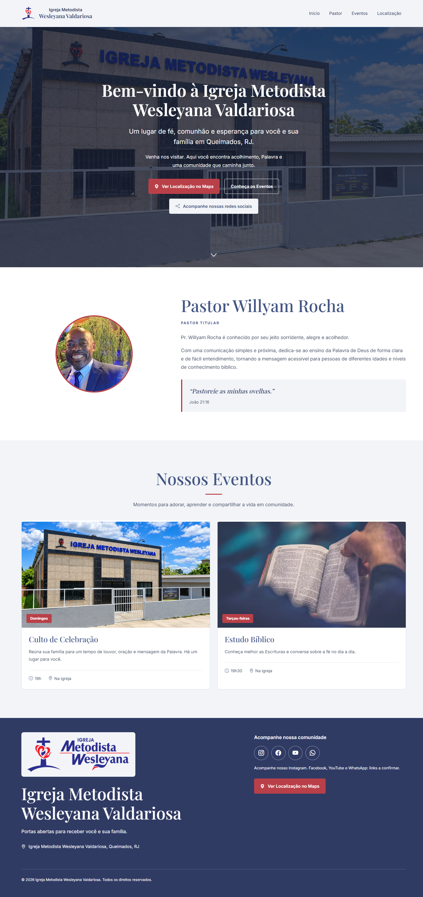

# Igreja Metodista Wesleyana Valdariosa

Uma landing page responsiva que reúne informações da igreja, apresentação do pastor, programação semanal, localização e acesso ao Instagram. O projeto transforma essas informações em uma experiência simples para quem deseja conhecer ou visitar a comunidade de Valdariosa, em Queimados, RJ.

**[Acessar demonstração](https://imwvproject.netlify.app/)** · **[Meu perfil no GitHub](https://github.com/Johnschiffer)**

## Sobre este projeto e minha busca por estágio

Estou em formação na área de desenvolvimento de software e busco uma oportunidade de estágio para aprender com uma equipe e contribuir em projetos reais. Este trabalho faz parte do meu portfólio e reúne práticas de desenvolvimento web, organização de código, testes em diferentes telas e atenção à experiência de quem utiliza o site.

O projeto foi construído e refinado com apoio de ferramentas de IA. Meu foco de aprendizado está em compreender as decisões, adaptar a solução aos requisitos e verificar o resultado no navegador. Este repositório apresenta o produto, seu código e sua documentação.

## Prévia

### Desktop



### Mobile


As prévias mostram a versão deste repositório. O site publicado no Netlify pode estar em uma versão anterior até o próximo deploy.

## O que a página oferece

- Apresentação da igreja e do Pr. Willyam Rocha.
- Culto de Celebração aos domingos, às 19h.
- Estudo Bíblico às terças-feiras, às 19h30.
- Botões para localização no Google Maps e navegação entre as seções.
- Acesso ao Instagram da igreja.
- Menu adaptado para celular e animações sutis ao rolar a página.

O card de Encontro de Jovens permanece comentado no HTML e não aparece na página. Facebook, YouTube e WhatsApp estão desativados até que seus links sejam confirmados.

## Tecnologias

| Tecnologia | Uso no projeto |
| --- | --- |
| HTML5 | Estrutura semântica, conteúdo e metadados |
| CSS3 | Identidade visual, alinhamento, responsividade e estados de interação |
| JavaScript | Menu mobile, compensação da navbar e atualização dos links de localização |
| Bootstrap 5.3.8 | Grid responsivo e componente de navegação |
| Bootstrap Icons 1.13.1 | Ícones de navegação, horários e redes sociais |
| AOS 2.3.4 | Animações de entrada |
| Netlify | Hospedagem e configuração de redirecionamento |

Sem framework JavaScript adicional, jQuery ou etapa de build. Bibliotecas, fontes e uma imagem ilustrativa do estudo bíblico são carregadas de serviços externos.

## Decisões técnicas e aprendizados

**Organização do código.** HTML, CSS e JavaScript ficam em arquivos separados. As imagens usam caminhos de arquivos em vez de Base64, facilitando leitura, manutenção e substituição dos recursos.

**Responsividade.** O grid adapta a apresentação para diferentes larguras. Um dos desafios foi manter o nome completo da igreja centralizado entre a logo e o botão do menu no mobile, além de alinhar o conteúdo do início no desktop.

**Acessibilidade.** A página possui link para pular ao conteúdo, foco visível, textos alternativos, nomes acessíveis nos controles e respeito à preferência de movimento reduzido. As cores de texto e botões foram verificadas para contraste.

**Desempenho.** As imagens utilizadas têm versões otimizadas. A foto principal passou de 2.930.451 para 327.770 bytes, uma redução de aproximadamente 89%. O card da fachada utiliza imagens responsivas; fotos abaixo da primeira tela usam carregamento lazy. Os arquivos originais foram preservados para futuras alterações.

**SEO.** O projeto inclui título e descrição com a localidade, canonical, Open Graph, Twitter Cards, JSON-LD com Church, WebSite e WebPage, robots.txt e sitemap. O redirecionamento Netlify evita duplicação entre a raiz do site e /index.html.

**Validação.** Foram conferidas as larguras de 320, 375, 768, 1024 e 1440px, menu, âncoras, imagens e links. Também foram verificados o conteúdo sem JavaScript e a visibilidade quando a biblioteca de animação não carrega.

Na auditoria local realizada, o Lighthouse registrou 100 em SEO, acessibilidade e boas práticas. São resultados de testes automáticos locais: não comprovam acessibilidade completa, resultados de Core Web Vitals em produção ou posicionamento no Google.

## Estrutura

```text
.
├── index.html
├── css/
│   └── style.css
├── js/
│   └── script.js
├── images/                 # Recursos utilizados e arquivos originais
├── docs/
│   └── images/             # Prévias do README
├── robots.txt
├── sitemap.xml
├── _redirects              # Regras da hospedagem Netlify
├── _headers                # Cabeçalhos da hospedagem Netlify
├── .gitignore
└── README.md
```

## Executar localmente

1. Clone o repositório:

   ```bash
   git clone https://github.com/Johnschiffer/imw-valdariosa.git
   cd imw-valdariosa
   ```

2. Abra `index.html` no navegador. Nenhuma instalação é necessária.
3. Mantenha as pastas `css`, `js` e `images` junto ao HTML. Uma conexão com a internet é necessária para os recursos externos.

Opcionalmente, caso Python esteja instalado, execute `python -m http.server 8000` e abra `http://localhost:8000/`.

## Personalizar e publicar

- Conteúdo, horários, links e metadados: `index.html`.
- Cores, alinhamento e estilos: `css/style.css`.
- Comportamento da navegação: `js/script.js`.
- Endereço e Maps: atributos `data-ENDERECO_IGREJA` e `data-MAPS_URL` no início do HTML.
- Ao mudar o domínio, atualize também canonical, metadados sociais, JSON-LD, robots.txt e sitemap.xml.

Para publicar no Netlify, envie os arquivos do site mantendo a estrutura de pastas. Não é necessário build. A publicação deste código no GitHub não altera automaticamente o deploy atual.

## Contato e créditos

Busco estágio em desenvolvimento de software. Você pode conhecer meus outros projetos e entrar em contato pelo **[perfil Johnschiffer](https://github.com/Johnschiffer)**.

Fotos, identidade visual e informações institucionais pertencem aos seus respectivos titulares. A imagem ilustrativa do estudo bíblico é carregada do Unsplash. Não foi adicionada licença que conceda direitos de reutilização sobre as imagens ou a marca da igreja.
